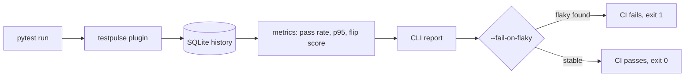

<p align="center">
  
</p>

<p align="center">
  <a href="https://github.com/shaikumar11/testpulse/actions/workflows/ci.yml"></a>
  
  
  
  
  
</p>

## The problem

Large teams run thousands of tests on every change. Some tests pass on one run and fail on the next with no code change. These **flaky tests** waste engineering time and hide real bugs. Slow tests quietly make every build longer.

## What TestPulse does

TestPulse is a pytest plugin that turns every test run into data.

| Feature | How |
|---|---|
| Records every result | Outcome and duration of each test saved to SQLite across runs |
| Pass rate | Per test and for the whole suite, skipped tests ignored |
| Speed | p95 duration per test, plus the slowest tests |
| Flaky detection | Flip score: share of consecutive runs where the outcome changed |
| CI quality gate | `--fail-on-flaky` exits with code 1 when flaky tests exist |

## How it works



## Quick start

```bash
pip install -r requirements.txt
pytest -p testpulse.plugin --testpulse-db=pulse.db      # run several times to build history
python -m testpulse.cli report --db pulse.db
python -m testpulse.cli report --db pulse.db --fail-on-flaky
```

## Example report

```text
TestPulse report
================
Tests tracked : 3
Suite pass rate: 88.9%
Flaky tests   : 1
  - tests/test_api.py::test_upload
Slowest by p95:
     417.0 ms  tests/test_api.py::test_upload
      93.0 ms  tests/test_db.py::test_query
      26.0 ms  tests/test_api.py::test_login
```

`test_upload` passed, failed, passed, passed, failed, passed across six runs. Its flip score is 0.8, so it is flagged as flaky.

## Quality

- 14 tests, 99% code coverage, enforced by a 90% gate in GitHub Actions
- An end to end test runs a real pytest session through the plugin and reads the stored telemetry
- Plugin state is kept per session, so nested or repeated sessions never overwrite each other

```bash
python -m coverage run --source=testpulse -m pytest -p testpulse.plugin --testpulse-db=pulse.db
python -m coverage report -m --fail-under=90
```

## Project structure

```text
testpulse/
  plugin.py    pytest plugin, records results per session
  store.py     SQLite schema and queries
  metrics.py   percentile, pass rate, flip score, summary
  report.py    text report
  cli.py       report command and CI gate
tests/         unit, CLI and end to end plugin tests
.github/workflows/ci.yml
```

## Built with

Python, pytest, SQLite, coverage.py, GitHub Actions
